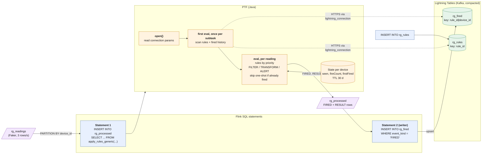

# flink-rules-lt

A Confluent Cloud Flink **Process Table Function (PTF)** that applies processing rules (filter, transform, alert, one-shot) to a stream of IoT readings. The rules, and the record of which rules already fired, are stored in **Lightning Tables**, so one-shot rules survive a statement recreate.

This is an experiment, not a production design. It relies on behaviour that the docs list as unsupported for PTFs (external connectivity), so it may break.

## Architecture



The loop that makes one-shot rules survive a recreate: the writer stores every `FIRED` row in `rg_fired`, and the next statement reads `rg_fired` at startup to restore its counts.

## How it works

1. Rules are written to the `rg_rules` Lightning Table.
2. At startup each PTF subtask reads `rg_rules` and `rg_fired` once, through the Lightning HTTP query API. It reaches the API through a Flink `CREATE CONNECTION` (raw HTTP from a PTF is blocked).
3. Readings are partitioned by `device_id`. For each reading the PTF applies the sensor's rules in `priority` order.
4. It emits a `FIRED` row for every rule that acted and a `RESULT` row unless a filter dropped the reading.
5. A second statement copies `FIRED` rows into `rg_fired`. This is the durable one-shot record that the next statement loads at startup.

Rule types:

| Type | Params | Effect |
|---|---|---|
| `FILTER` | `{"min","max"}` | Outside the range: reading dropped, later rules skipped |
| `TRANSFORM` | `{"fn":"C_TO_F"\|"HPA_TO_PSI"}` | Converts the value and sets the unit |
| `ALERT` | `{"above"}` | Raw value above the threshold sets `alert = true` |

A rule with `one_shot = true` acts only once per (rule, device).

## Layout

```
src/main/java/demo/iot/   ApplyRulesGenericPtf (the PTF), RuleClient (Lightning query client)
sql/                      DDL, example rules, the run statement, the fired-table writer
docs/flink-rules-lt.html  Full write-up with diagram and test results
CLAUDE.md                 Detailed notes, findings and gotchas
```

## Setup

Requirements: Confluent Cloud with Flink, an AWS Kafka cluster in a region that supports Lightning Tables, Schema Registry, a Global API key, Java 11+ and Maven.

The files contain placeholders such as `<ENV_ID>`, `<CLUSTER_ID>`, `<ENV_NAME>`, `<CLUSTER_NAME>` and `<ARTIFACT_ID>`. Replace them with your own values.

1. Build: `mvn -q clean package` produces `target/flink-rules-lt-1.0.0.jar`.
2. Upload the JAR as a Flink artifact (`confluent flink artifact create ... --runtime-language java`).
3. Run the SQL in order:

| File | Purpose |
|---|---|
| `03_connection.sql` | `CREATE CONNECTION lightning_connection` (put your Global API key in) |
| `30_generic_rules.sql`, `31_generic_fired.sql` | Create `rg_rules` and `rg_fired`, then enable Lightning on both topics |
| `32_generic_rules_data.sql` | Nine example rules |
| `33_generic_io.sql` | Faker source `rg_readings` and output `rg_processed` |
| `34_generic_run.sql` | `CREATE FUNCTION` (see the comment) and the PTF statement |
| `35_generic_fired_writer.sql` | Writer from `rg_processed` into `rg_fired` |

## Known limits

- Rules and history are loaded once per subtask. A rule edit needs a statement recreate.
- A firing that has not yet reached `rg_fired` is invisible to a recreated statement, so a one-shot rule can fire twice.
- History older than 30 days is ignored.
- Startup fails if a Lightning scan fails (by design).

See `docs/flink-rules-lt.html` for the test results and `CLAUDE.md` for the details.
